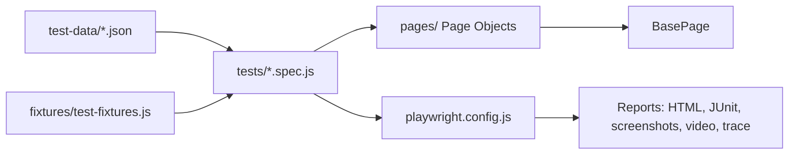

# Playwright E2E Automation: SauceDemo

[](https://github.com/paresagarqa-git/playwright-saucedemo-automation/actions/workflows/playwright.yml)


End-to-end UI test automation for [saucedemo.com](https://www.saucedemo.com), a demo e-commerce
application. Built with **Playwright Test** in **JavaScript** using the **Page Object Model**, custom
fixtures, data-driven tests, cross-browser and parallel execution, and a **GitHub Actions** CI pipeline
that runs on every pull request.

## Highlights

- **25 tests per browser, 100 per run** across Chromium, Firefox, WebKit (Safari) and Microsoft Edge
- **Page Object Model** with a shared `BasePage` and **custom fixtures** (`loggedInPage`, page objects injected into tests)
- **Data-driven tests** from JSON files: add a row and you get a new test with no code change
- **Parallel execution** at three levels: tests, workers and CI shards (8 jobs at once)
- **Failure evidence**: full-page screenshot, video and Playwright trace for every failed test
- **Reports**: HTML report (merged across all CI jobs), JUnit XML and inline GitHub annotations
- **CI/CD**: GitHub Actions on every PR and push to `main`, with protected `main` and required checks
- **Team workflow**: feature branches, focused commits, pull requests, issues linked to bug fixes

## Tech stack

| Area | Tool |
|------|------|
| Test framework | [Playwright Test](https://playwright.dev) (`@playwright/test`) |
| Language | JavaScript (Node.js 20) |
| Design pattern | Page Object Model + custom fixtures |
| Test data | JSON + JS modules in `test-data/` |
| Reporting | Playwright HTML, JUnit XML, GitHub annotations |
| CI/CD | GitHub Actions (matrix of browsers x shards, merged reports) |

## Framework design



- **Tests** describe *what* is verified and stay readable: no raw selectors inside specs.
- **Page objects** own *how* to interact with each screen (locators + actions). Locators use
  `getByTestId` mapped to SauceDemo's `data-test` attributes, the most stable selector strategy.
- **Fixtures** create page objects for each test and provide a ready, logged-in state (`loggedInPage`),
  so tests are short and fully isolated.
- **Test data** lives outside the tests, so the same test logic runs against many inputs.
- **Config** controls browsers, parallelism, retries, timeouts, base URL and failure evidence in one place.

## Project structure

```
.
├── .github/workflows/
│   └── playwright.yml        # CI: 4 browsers x 2 shards in parallel, merged report
├── fixtures/
│   └── test-fixtures.js      # Custom fixtures: page objects + loggedInPage
├── pages/                    # Page Object Model
│   ├── BasePage.js           # Shared header, cart and menu actions
│   ├── LoginPage.js
│   ├── InventoryPage.js
│   ├── CartPage.js
│   └── CheckoutPage.js
├── test-data/
│   ├── login-data.json       # Valid users + failed-login cases
│   ├── checkout-data.json    # Customer details + form validation cases
│   ├── products.js           # Product names and prices
│   └── users.js              # Default account for the loggedInPage fixture
├── tests/
│   ├── auth/login.spec.js
│   ├── inventory/sorting.spec.js
│   ├── cart/cart.spec.js
│   ├── checkout/checkout.spec.js
│   └── demo/demo-failure.spec.js   # Intentional failure (opt-in) to demo reporting
├── playwright.config.js
└── package.json
```

## Test scenarios

| # | Area | Scenario | Tag |
|---|------|----------|-----|
| 1 | Login | 5 different users log in successfully and see the product list (data-driven) | `@smoke` |
| 2 | Login | 8 failed-login cases show the correct error: locked-out user, empty fields, wrong password, unknown user, wrong case, SQL injection (data-driven) | `@regression` |
| 3 | Session | User logs out and returns to the login page | `@smoke` |
| 4 | Session | Inventory page is blocked without login | `@regression` |
| 5 | Inventory | Sort products by price (low to high, high to low) and name (Z to A) | `@regression` |
| 6 | Cart | Adding and removing items updates the cart badge | `@smoke` |
| 7 | Cart | Cart keeps its items after navigating away | `@regression` |
| 8 | Checkout | Full order end to end, verifying subtotal, tax and total | `@smoke` |
| 9 | Checkout | Form validation for missing first name, last name, postal code, all fields (data-driven) | `@regression` |

Run a subset by tag: `npm run test:smoke` or `npm run test:regression`.

## Data-driven testing

Test data is kept separate from test logic in `test-data/`. Specs loop over the data, and
**each row becomes its own test** in the report.

```json
// test-data/login-data.json (excerpt)
{
  "validUsers": [
    { "username": "standard_user", "password": "secret_sauce", "description": "standard user" }
  ],
  "invalidLogins": [
    { "description": "wrong password", "username": "standard_user", "password": "wrong_password",
      "error": "Epic sadface: Username and password do not match any user in this service" }
  ]
}
```

```js
// tests/auth/login.spec.js (excerpt)
for (const data of loginData.invalidLogins) {
  test(`shows an error for ${data.description}`, async ({ loginPage }) => {
    await loginPage.goto();
    await loginPage.login(data.username, data.password);
    await expect(loginPage.errorMessage).toHaveText(data.error);
  });
}
```

| File | Contents |
|------|----------|
| `login-data.json` | `validUsers` (5 accounts) and `invalidLogins` (8 cases with expected errors) |
| `checkout-data.json` | Customer details and `invalidForms` validation cases |
| `products.js` | Product names and prices used in cart and checkout tests |
| `users.js` | Default account for the `loggedInPage` fixture (password overridable with `SAUCE_PASSWORD`) |

## Cross-browser and parallel execution

| Project | Engine | Command |
|---------|--------|---------|
| `chromium` | Chrome / Chromium | `npm run test:chromium` |
| `firefox` | Firefox | `npm run test:firefox` |
| `webkit` | Safari engine | `npm run test:webkit` |
| `edge` | Microsoft Edge | `npm run test:edge` (requires `npx playwright install msedge`) |

`npm test` or `npm run test:cross-browser` runs all four.

Parallelism works at three levels:

1. **Tests**: `fullyParallel: true` lets every test run concurrently in its own isolated browser context.
2. **Workers**: 4 worker processes on CI, 50% of CPU cores locally. Override with `WORKERS=6 npm test`,
   or use `npm run test:serial` to debug with one worker.
3. **Shards (CI)**: each browser's tests are split across 2 shards, so **8 jobs run at once**. A final
   `merge reports` job combines them into a single HTML report.

## Reports and failure evidence

| Artifact | When | Where |
|----------|------|-------|
| HTML report | Every run | `playwright-report/`. Open with `npm run report` |
| JUnit XML | Every run | `test-results/junit.xml` (CI: inside the `playwright-report` artifact) |
| Full-page screenshot | Failed tests | Attached in the HTML report and in `test-results/` |
| Video (`.webm`) | Failed tests | Attached in the HTML report and in `test-results/` |
| Trace (`trace.zip`) | Failed tests | Open from the HTML report or with `npx playwright show-trace <file>` |

**In CI**, download the `playwright-report` artifact from the run page, unzip it, and run
`npx playwright show-report playwright-report`. Failed jobs also upload `failure-evidence-<browser>-<shard>`
with raw screenshots, videos and traces. The run summary shows a pass/fail table.

**See it in action:** `tests/demo/demo-failure.spec.js` contains an intentional failure that is skipped
by default. Run it locally with `DEMO_FAILURE=1 npx playwright test tests/demo --project=chromium`, or in
GitHub via **Actions → Playwright Tests → Run workflow → demo_failure**.

## Getting started

**Prerequisites:** Node.js 18+ and Git.

```bash
git clone https://github.com/paresagarqa-git/playwright-saucedemo-automation.git
cd playwright-saucedemo-automation
npm ci
npx playwright install --with-deps
```

| Command | What it does |
|---------|--------------|
| `npm test` | Run all tests on all browsers, headless |
| `npm run test:headed` | Run with a visible browser |
| `npm run test:ui` | Open Playwright UI mode (watch, step through, time-travel) |
| `npm run test:smoke` | Run only `@smoke` tests |
| `npm run test:regression` | Run only `@regression` tests |
| `npm run test:chromium` (or `firefox`, `webkit`, `edge`) | Run one browser |
| `npm run test:parallel` / `npm run test:serial` | Run with 4 workers or 1 worker |
| `npm run report` | Open the last HTML report |

**Configuration** via environment variables:

| Variable | Default | Purpose |
|----------|---------|---------|
| `BASE_URL` | `https://www.saucedemo.com` | Application under test |
| `WORKERS` | 4 on CI, 50% of cores locally | Parallel worker count |
| `SAUCE_PASSWORD` | `secret_sauce` | Password for the default account |
| `DEMO_FAILURE` | unset | Set to `1` to run the intentional demo failure |

## CI/CD pipeline

`.github/workflows/playwright.yml` runs on every pull request, on every push to `main`, and on demand:

1. **Test matrix**: 4 browsers x 2 shards = 8 parallel jobs, each with 4 workers and 2 retries on failure
2. **Artifacts**: blob reports per shard, plus screenshots, videos and traces when a test fails
3. **Merge reports**: one combined HTML report and JUnit file, plus a pass/fail summary on the run page

A final `test` job passes only if every browser and shard passed. `main` is protected: changes land only
through pull requests, and the `test` check must pass before merge.

## Development workflow

- One **feature branch** per change (`feature/...`, `fix/...`, `ci/...`, `docs/...`)
- **Conventional commit** messages (`feat:`, `test:`, `fix:`, `ci:`, `docs:`, `refactor:`)
- **Pull request** for every change, with CI required to pass before merge
- Bugs tracked as **GitHub issues** and closed by the fixing PR (see issue #1 and PR #7)

See the [pull requests](https://github.com/paresagarqa-git/playwright-saucedemo-automation/pulls?q=is%3Apr)
and [commit history](https://github.com/paresagarqa-git/playwright-saucedemo-automation/commits/main).
